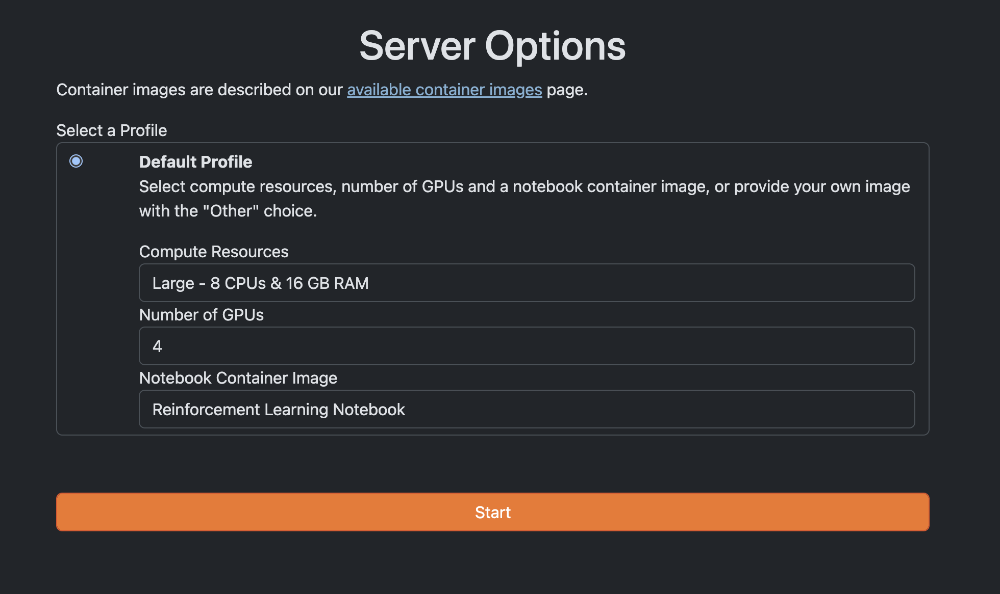

# Modular Flappy Bird Project

The original prototype placed the environment, Q-learning agent, experiments,
plotting, and command-line runner in one file.  This version separates those
responsibilities:

| File | Responsibility |
| --- | --- |
| `flappy_bird_env.py` | Game physics, pipes, collisions, observations, rewards, and rendering |
| `environment.py` | Small project wrapper around the Gymnasium environment |
| `agent.py` | Base agent interface |
| `agent_q_learning.py` | State discretization and tabular Q-learning |
| `argument.py` | Command-line options |
| `experiments.py` | Training, evaluation, and experiment configurations |
| `plotting.py` | Learning curves and JSON output |
| `main.py` | Command-line entry point |
| `flappy_rl.py` | Compatibility launcher for the original command |

## Set up the notebook environment

If you are using the hosted notebook environment, select the options shown
below.  The project can run on a CPU, so four GPUs are optional and are not
required for the tabular Q-learning experiments.



Select the reinforcement-learning notebook image and click **Start**.  After
the notebook server opens, upload or copy all of the project files into the
same folder, then open a terminal in that folder.

Install the required Python packages:

```bash
pip install -r requirements.txt
```

You can check that the files and dependencies work with a short run first:

```bash
python main.py --episodes 20 --eval-episodes 2 --seeds 0 --workers 1
```

## Run the complete project

```bash
python flappy_rl.py
```

To use multiple CPU workers:

```bash
python main.py --workers 3
```

## Record evaluation videos

To save five evaluation episodes for each configuration as MP4 files, run:

```bash
python main.py --record-video --video-episodes 5
```

The videos are saved in the `videos/` directory. Video recording is performed
only for the seed-0 evaluation run of each configuration, so the command does
not create a video for every training episode. Recording automatically uses
one worker because multiple workers should not write to the same video folder.

If video export reports that MoviePy is missing, install the requirements again:

```bash
pip install -r requirements.txt
```

The default run writes `results/pilot.json` and
`figures/learning_curve.pdf`. Video-enabled runs also write MP4 files to
`videos/`.

The JSON file contains the scores and experiment statistics.  The PDF file
contains the training curves for the three Q-learning configurations.

## Progress report

The Stage 2 project progress report and the video-frame evidence are in the
[`report/`](report/) folder.
